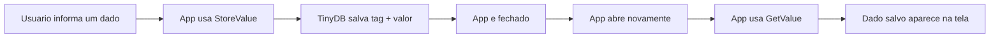

# App Inventor: Manipulacao de Banco de Dados no Dispositivo com TinyDB
**Integrantes:** Davi Bressan, Gustavo Bastos, Bianca Rocha, Kevin Nozaki.
**Curso:** 2°D

## 1. O que e o MIT App Inventor?

O MIT App Inventor e uma plataforma online criada para desenvolver aplicativos de forma visual, usando blocos de programacao. Em vez de escrever todo o codigo manualmente, o usuario monta a logica do aplicativo encaixando blocos, parecidos com pecas. Isso facilita bastante para quem esta comecando, porque a pessoa consegue aprender conceitos de programacao enquanto ja ve o aplicativo funcionando no celular.

Segundo a propria documentacao do MIT App Inventor, a ferramenta permite criar aplicativos para celulares e tablets diretamente pelo navegador (MASSACHUSETTS INSTITUTE OF TECHNOLOGY, 2025a). Ela tambem foi pensada para tornar o desenvolvimento de software mais acessivel, principalmente para estudantes e iniciantes (MASSACHUSETTS INSTITUTE OF TECHNOLOGY, 2025b).

Na pratica, o App Inventor pode ser usado para criar aplicativos simples ou intermediarios, como calculadoras, jogos, agendas, listas de tarefas, aplicativos educativos, cadastros e prototipos. Suas principais vantagens para iniciantes sao:

- nao exige conhecimento avancado de linguagem de programacao;
- usa blocos visuais, o que diminui erros de sintaxe;
- permite testar o app no celular durante o desenvolvimento;
- possui componentes prontos, como botoes, caixas de texto, banco de dados local, sensores e conexao com a internet;
- ajuda a entender logica de programacao de um jeito mais direto.

## 2. O que e o TinyDB?

O TinyDB e um componente de armazenamento do MIT App Inventor. Ele serve para guardar informacoes no proprio dispositivo, de forma persistente. Isso significa que os dados continuam salvos mesmo depois que o usuario fecha o aplicativo e abre novamente.

A documentacao oficial explica que os aplicativos criados no App Inventor sao inicializados novamente a cada execucao. Portanto, se o app guardar uma informacao apenas em uma variavel comum, essa informacao sera perdida quando o aplicativo for fechado. O TinyDB resolve esse problema porque funciona como um pequeno armazenamento permanente do app (MASSACHUSETTS INSTITUTE OF TECHNOLOGY, 2024a).

Os dados ficam armazenados localmente no dispositivo do usuario. Assim, o aplicativo nao precisa de internet para salvar ou recuperar essas informacoes. Um exemplo simples e um jogo que guarda a maior pontuacao do jogador. Mesmo depois de fechar o app, a pontuacao continua salva para ser exibida na proxima vez.

### Vantagens do TinyDB

- funciona sem internet;
- e simples de usar;
- salva dados de forma persistente;
- e adequado para informacoes pequenas e medias;
- pode ser usado em aplicativos simples, como listas, cadastros e configuracoes.

### Limitacoes do TinyDB

- os dados ficam apenas no aparelho onde o app foi instalado;
- nao serve para compartilhar dados entre usuarios diferentes;
- nao e indicado para grandes bancos de dados;
- se o aplicativo for desinstalado, os dados podem ser perdidos;
- durante testes no Companion, diferentes projetos podem compartilhar o mesmo TinyDB, por isso e preciso tomar cuidado e limpar dados antigos quando necessario (MASSACHUSETTS INSTITUTE OF TECHNOLOGY, 2024a).

## 3. Funcionamento do TinyDB

O TinyDB trabalha com a ideia de **tag** e **valor**. A tag funciona como uma chave ou nome usado para identificar a informacao. O valor e o dado que fica guardado nessa tag.

Por exemplo:

| Tag | Valor armazenado |
| --- | --- |
| `nomeUsuario` | `Ana` |
| `pontuacaoMaxima` | `1500` |
| `listaCompras` | `["arroz", "feijao", "leite"]` |

De acordo com a documentacao do MIT App Inventor, cada item armazenado no TinyDB e formado por uma tag e um valor. Para salvar uma informacao, e necessario indicar em qual tag ela sera guardada. Depois, o aplicativo pode buscar o valor usando a mesma tag (MASSACHUSETTS INSTITUTE OF TECHNOLOGY, 2024a).

### Gravacao de informacoes

Para gravar uma informacao, usa-se o bloco `StoreValue`. Ele recebe dois dados:

- a tag, que identifica a informacao;
- o valor que sera salvo.

Exemplo: em uma tela de cadastro simples, o usuario digita seu nome em uma caixa de texto. Ao clicar no botao "Salvar", o app pode guardar:

- tag: `nomeUsuario`;
- valor: texto digitado pelo usuario.

Assim, na proxima vez que o app abrir, o nome ainda estara salvo.

### Leitura de informacoes

Para ler uma informacao, usa-se o bloco `GetValue`. O aplicativo informa a tag desejada e tambem um valor padrao, caso aquela tag ainda nao exista.

Exemplo:

- buscar a tag `nomeUsuario`;
- se ela existir, mostrar o nome salvo;
- se nao existir, mostrar uma mensagem como "Usuario nao cadastrado".

Esse valor padrao e importante porque evita erro quando o app tenta buscar uma informacao que ainda nao foi cadastrada.

### Atualizacao de dados

Atualizar um dado no TinyDB e parecido com salvar. Basta usar `StoreValue` novamente com a mesma tag. O novo valor substitui o anterior.

Exemplo: se a tag `pontuacaoMaxima` tinha o valor `1500` e o jogador fez `1800`, o app grava `1800` na mesma tag. A partir desse momento, o valor antigo deixa de ser usado.

### Remocao de dados

Para remover informacoes, o TinyDB oferece blocos como `ClearTag` e `ClearAll`.

- `ClearTag` remove apenas uma tag especifica.
- `ClearAll` apaga todo o armazenamento do TinyDB daquele app.

Por exemplo, em um app com login simples, o botao "Sair" poderia apagar a tag `usuarioLogado`. Ja um botao "Limpar tudo" em uma lista de tarefas poderia usar `ClearAll`, mas isso precisa ser feito com cuidado, porque apaga todos os dados salvos.

## 4. Componentes e blocos relacionados

Os principais blocos do TinyDB sao simples, mas cada um tem um uso especifico.

| Bloco | Funcao | Quando usar |
| --- | --- | --- |
| `StoreValue(tag, valueToStore)` | Salva um valor em uma tag | Quando o app precisa gravar ou atualizar uma informacao |
| `GetValue(tag, valueIfTagNotThere)` | Recupera o valor de uma tag | Quando o app precisa carregar uma informacao salva |
| `ClearTag(tag)` | Apaga uma tag especifica | Quando so uma informacao deve ser removida |
| `ClearAll()` | Apaga todos os dados do TinyDB | Quando o usuario quer limpar tudo ou reiniciar o app |
| `GetTags()` | Retorna a lista de tags salvas | Quando o app precisa saber quais registros existem |
| `GetEntries()` | Retorna os dados em formato de dicionario | Quando e necessario recuperar o conjunto de informacoes salvas |

Esses blocos aparecem na documentacao oficial do componente TinyDB, dentro da categoria Storage do App Inventor (MASSACHUSETTS INSTITUTE OF TECHNOLOGY, 2024a).

## 5. Aplicacoes praticas

O TinyDB e adequado para aplicativos que precisam lembrar informacoes simples no proprio aparelho. Ele combina bem com projetos em que os dados pertencem ao usuario daquele celular e nao precisam ser compartilhados com outras pessoas.

Algumas possibilidades:

- **Lista de tarefas:** salvar tarefas pendentes e concluidas.
- **Agenda de contatos simples:** guardar nome, telefone e observacoes.
- **Cadastro de clientes:** armazenar uma lista pequena de clientes atendidos pelo usuario.
- **Lista de compras:** salvar itens que o usuario adicionou.
- **Aplicativo de anotacoes:** guardar textos curtos.
- **Controle financeiro pessoal:** salvar gastos inseridos pelo usuario.
- **Jogos:** guardar recorde, fase atual ou configuracoes.

## 6. TinyDB x TinyWebDB

O TinyDB e o TinyWebDB tem nomes parecidos, mas funcionam de formas diferentes.

| Comparacao | TinyDB | TinyWebDB |
| --- | --- | --- |
| Onde os dados ficam | No proprio dispositivo | Em um servico web |
| Precisa de internet | Nao | Sim |
| Compartilha dados entre usuarios | Nao, normalmente fica no aparelho | Pode compartilhar, pois os dados ficam online |
| Dificuldade | Mais simples | Mais complexo |
| Melhor uso | Dados locais, configuracoes, listas pessoais | Dados que precisam ser acessados por mais de um aparelho |
| Risco principal | Perda dos dados se o app for removido | Depender de servidor e internet |

A documentacao oficial informa que o TinyWebDB se comunica com um servico web para armazenar e recuperar informacoes. A propria pagina do MIT tambem explica que o servico padrao e limitado e funciona mais como demonstracao, sendo recomendado criar um servico proprio para projetos mais serios (MASSACHUSETTS INSTITUTE OF TECHNOLOGY, 2024b).

Assim, o TinyDB deve ser usado quando os dados sao locais, como uma lista de tarefas pessoal. O TinyWebDB faz mais sentido quando os dados precisam ficar na web, como em um jogo com ranking compartilhado ou em um app usado por mais de um celular.
Nesses casos, o TinyDB e uma boa escolha porque o aplicativo consegue salvar e recuperar dados rapidamente, sem depender de servidor externo. Para um trabalho escolar, por exemplo, um app de lista de compras com TinyDB ja mostra bem a ideia de banco local: o usuario adiciona um item, fecha o app e, quando abre de novo, a lista continua la.
- **Controle financeiro pessoal:** salvar gastos inseridos pelo usuario.
- **Jogos:** guardar recorde, fase atual ou configuracoes.

## 7. Boas praticas no uso do TinyDB

Algumas boas praticas ajudam a deixar o aplicativo mais organizado e evitam perda ou confusao de dados.

### Escolher bons nomes para as tags

As tags devem ter nomes claros. Em vez de usar `x1` ou `dado`, e melhor usar nomes como:

- `nomeUsuario`;
- `listaTarefas`;
- `pontuacaoMaxima`;
- `configuracaoTema`.

Isso facilita a manutencao do app, principalmente quando o projeto cresce.

### Organizar os dados

Quando houver varios dados relacionados, pode ser melhor guardar uma lista ou dicionario em uma unica tag. Por exemplo, em vez de criar varias tags soltas para itens de compra, o app pode guardar uma lista na tag `listaCompras`.

### Sempre pensar no valor padrao

Ao usar `GetValue`, o app deve informar um valor padrao. Isso evita problemas quando a tag ainda nao existe. Se o app busca uma lista, o valor padrao pode ser uma lista vazia. Se busca um nome, pode ser um texto vazio.

### Atualizar com cuidado

Antes de atualizar listas, o ideal e seguir uma ordem:

1. buscar a lista salva com `GetValue`;
2. alterar a lista no aplicativo;
3. salvar novamente com `StoreValue`.

Assim o app nao perde informacoes antigas por acidente.

### Evitar apagar tudo sem necessidade

O bloco `ClearAll` deve ser usado com cuidado. Em muitos casos, `ClearTag` e mais seguro, porque apaga apenas uma informacao especifica. Se o aplicativo tiver um botao para limpar todos os dados, e recomendavel pedir confirmacao ao usuario.

### Testar o app depois de fechar e abrir

Como o objetivo do TinyDB e manter dados salvos, um teste importante e fechar o aplicativo e abrir novamente para verificar se as informacoes continuam corretas.

## 8. Conclusao

O TinyDB e importante no desenvolvimento de aplicativos porque permite guardar informacoes no proprio dispositivo de forma simples. Sem ele, muitos dados seriam perdidos sempre que o aplicativo fosse fechado, como nome de usuario, listas, pontuacoes e configuracoes.

Ele pode ser usado em varios tipos de aplicativos, principalmente aqueles que precisam salvar dados locais e nao dependem de internet. Para projetos de iniciantes no MIT App Inventor, o TinyDB e uma boa forma de entender a ideia de banco de dados, chaves, valores, leitura, gravacao, atualizacao e exclusao.
