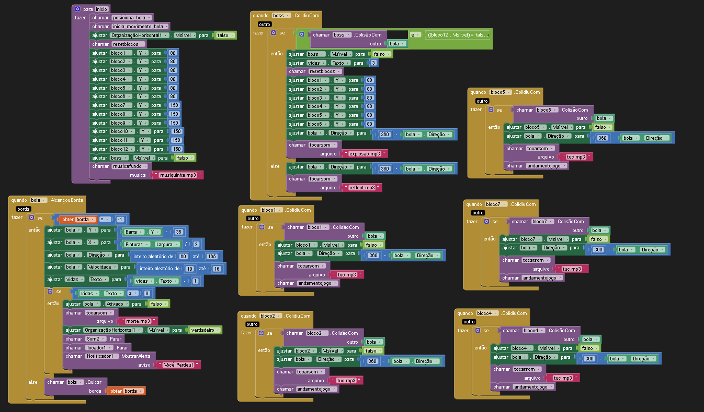
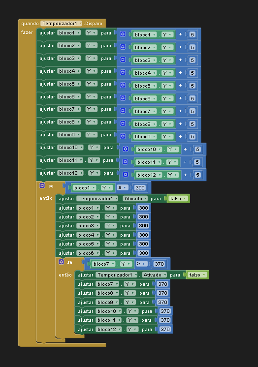

## Instituição

`ETEC Vasco Antônio Venchiarutti`

---

## Curso

`Informática para Internet`

---

## Disciplina

`DDM – Desenvolvimento para Dispositivos Móveis`

---

## Turma

`2°D`

---

## Autores

* `Gustavo`
* `Bianca`

---

# Relatório – Desenvolvimento de Jogos no MIT App Inventor

## Objetivo

O objetivo deste trabalho foi desenvolver e personalizar três jogos utilizando o MIT App Inventor, aplicando conceitos de programação por blocos, lógica de jogos, física de elementos e utilização dos sensores do dispositivo móvel.

---

# Projeto 1 – Pong Master

## Objetivo do jogo

O jogo consiste em controlar uma barra para impedir que a bola saia da tela, rebatendo-a continuamente. O objetivo é manter a bola em movimento pelo maior tempo possível e acumular pontuação.

## Modificações realizadas (Gustavo)

Foi implementada uma mecânica de evento onde surge um **chefão a cada 10 pontos conquistados**. Essa adição altera o ritmo normal da partida, exigindo maior agilidade do jogador para superar o desafio e continuar avançando.

---

## Print do Design

## Print dos Blocos

---

# Projeto 2 – Acelerômetro

## Objetivo do jogo

Neste jogo, o jogador utiliza a inclinação do celular para controlar a movimentação da bola na tela, tentando levá-la até o ponto de destino.

## Modificações realizadas (Gustavo)

Foi adicionado um elemento de física e aleatoriedade ao jogo: existe uma **chance de ocorrer um vento forte em uma direção aleatória**. Essa força externa altera a trajetória da bola repentinamente, exigindo que o jogador reaja rápido e compense o movimento inclinando o aparelho com maior precisão.

---

## Print do Design

## Print dos Blocos

---
