## Instituição

`ETEC Vasco Antônio Venchiarutti`

---

## Curso

`Informática para Internet`

---

## Disciplina

`DDM – Desenvolvimento para Dispositivos Móveis`

---

## Turma

`2°D`

---

## Autores

* `Gustavo`
* `Bianca`

---

# Relatório – Desenvolvimento de Jogos no MIT App Inventor

## Objetivo

O objetivo deste trabalho foi desenvolver e personalizar três jogos utilizando o MIT App Inventor, aplicando conceitos de programação por blocos, lógica de jogos, física de elementos e utilização dos sensores do dispositivo móvel.

---

# Projeto 1 – Pong Master

## Objetivo do jogo

O jogo consiste em controlar uma barra para impedir que a bola saia da tela, rebatendo-a continuamente. O objetivo é manter a bola em movimento pelo maior tempo possível e acumular pontuação.

## Modificações realizadas (Gustavo)

Foi implementada uma mecânica de evento onde surge um **chefão a cada 10 pontos conquistados**. Essa adição altera o ritmo normal da partida, exigindo maior agilidade do jogador para superar o desafio e continuar avançando.

---

## Print do Design

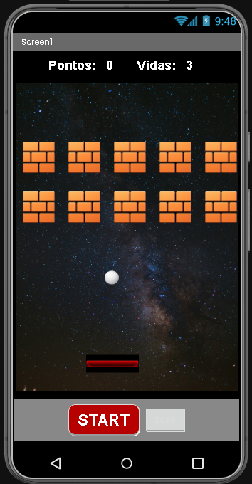

## Print dos Blocos

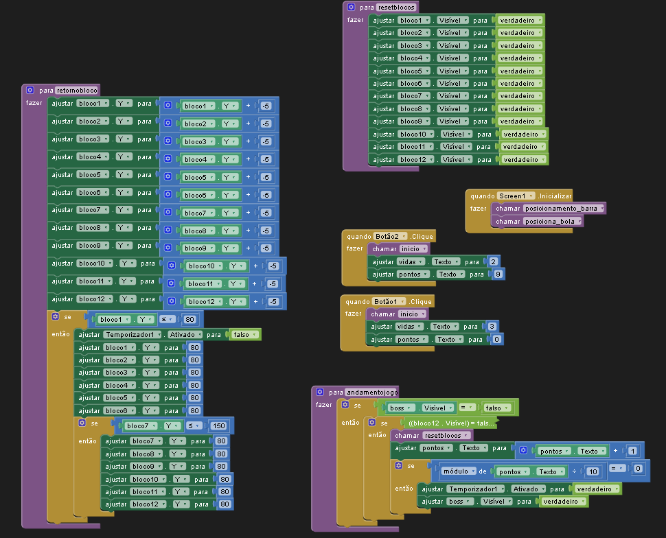
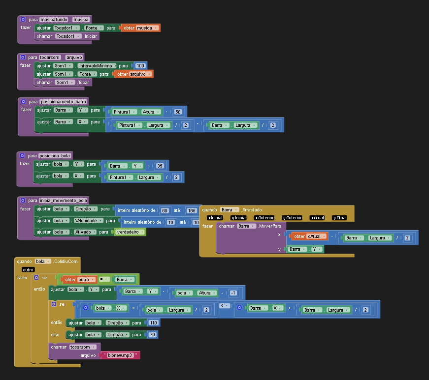

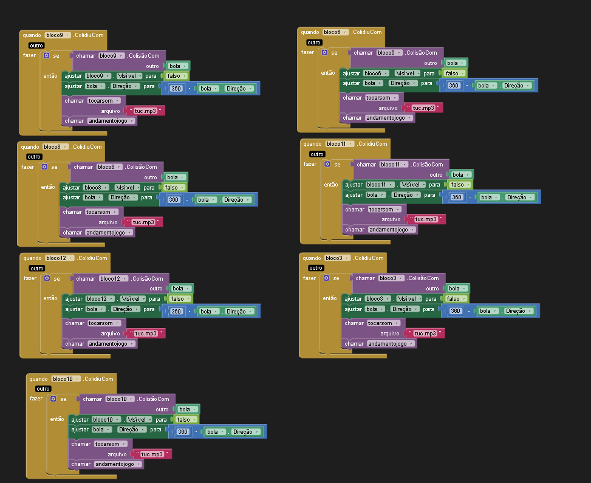

---

# Projeto 4 – Carro

## Objetivo do jogo

O jogo é de um carro que precisa desviar de pedras em uma rodovia. O jogador usa o acelerômetro do celular para movimentar o carro para a direita e para a esquerda.

## Modificações realizadas (Gustavo)

Foi adicionado o acelerômetro para controlar o carro inclinando o celular. Também foi adicionado um sistema de colisão com as pedras. Quando o carro bate em uma pedra, ela sorteia uma nova posição, podendo aparecer no lado direito ou esquerdo da rodovia.

---

## Print do Design

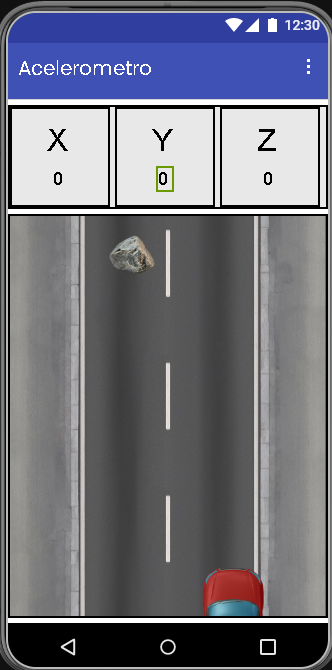

## Print dos Blocos

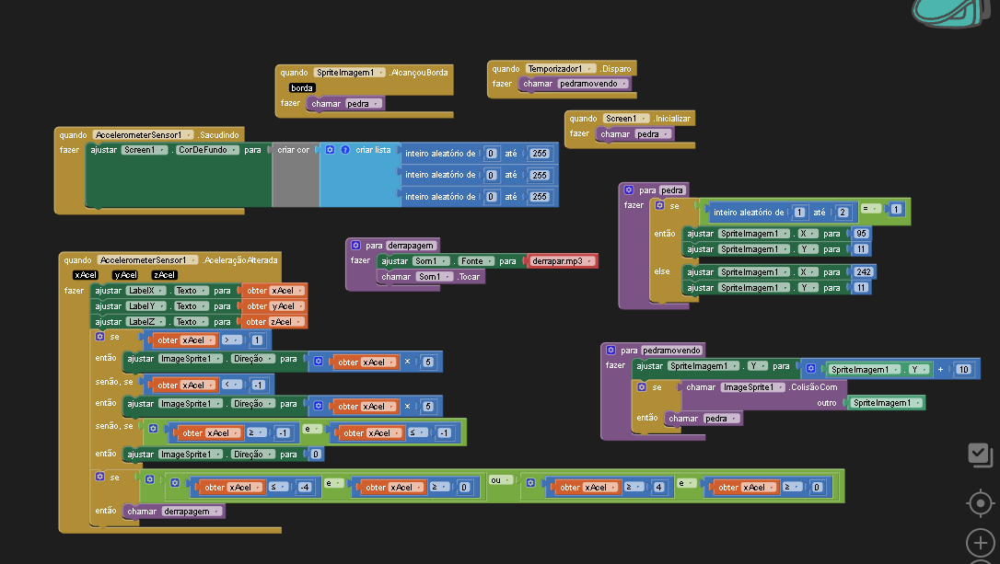

---

# Projeto 2 – Acelerômetro 2 (Magic Ball)

## Objetivo do jogo

Neste jogo, o jogador utiliza a inclinação do celular para controlar a movimentação da bola na tela, tentando levá-la até o ponto de destino.

## Modificações realizadas (Gustavo)

Foi adicionado um elemento de física e aleatoriedade ao jogo: existe uma **chance de ocorrer um vento forte em uma direção aleatória**. Essa força externa altera a trajetória da bola repentinamente, exigindo que o jogador reaja rápido e compense o movimento inclinando o aparelho com maior precisão.

---

## Print do Design

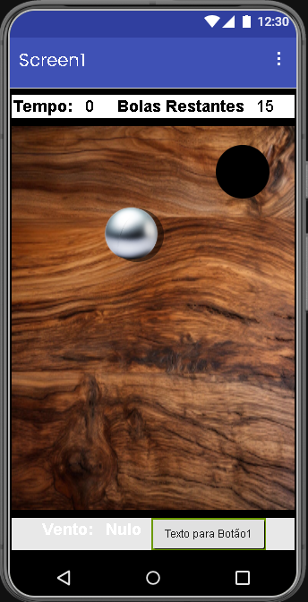

## Print dos Blocos

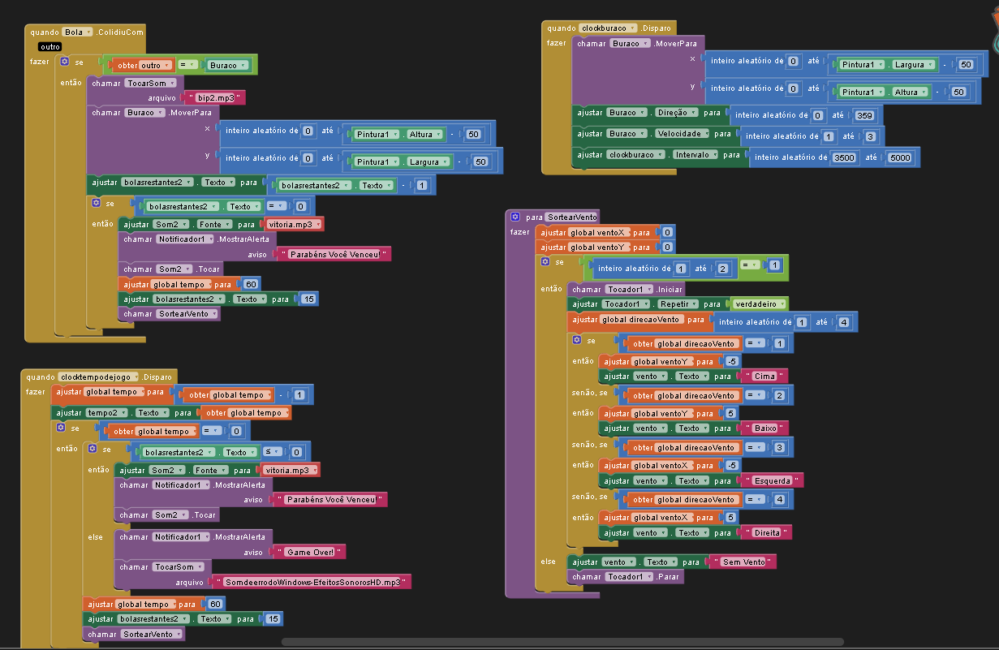
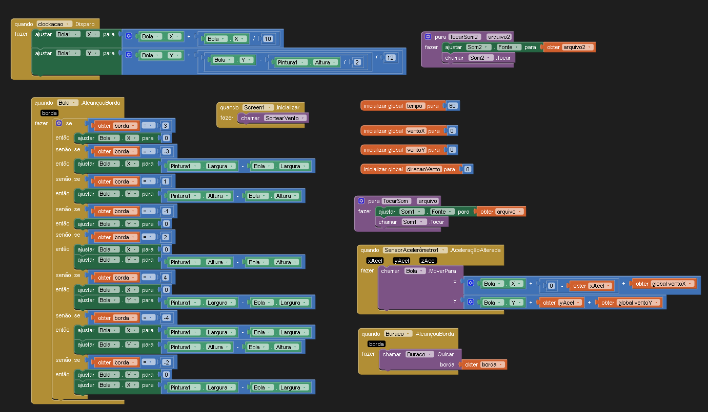

---

# Projeto 3 – Bilhar

## Objetivo do jogo

O jogo simula uma mesa de sinuca com interação direta dos elementos na tela.

## Modificações realizadas (Bianca)

Foi introduzida uma **bola amarela com sistema de pontuação**. Para conseguir marcar pontos na partida, o jogador precisa ajustar a trajetória e encaçapar a bola amarela no buraco da mesa.

---

## Print do Design

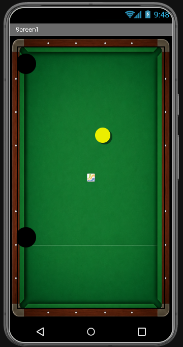

## Print dos Blocos

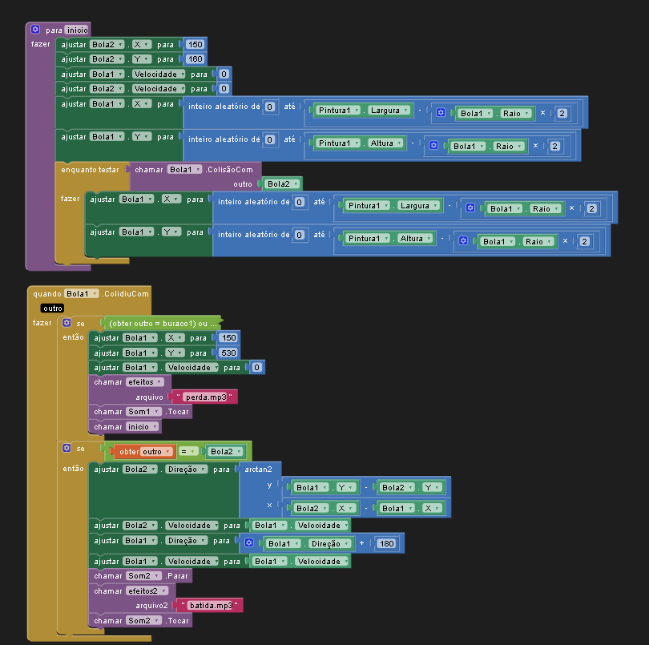
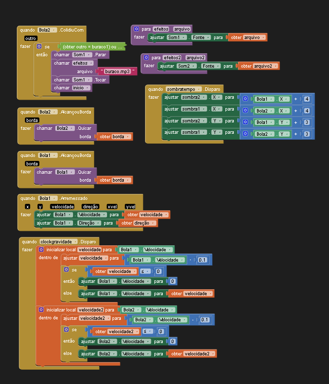

---

# Considerações Finais

O desenvolvimento das alterações nos três jogos permitiu aplicar na prática os conceitos estudados na disciplina de Desenvolvimento para Dispositivos Móveis (DDM), utilizando programação por blocos no MIT App Inventor. As modificações realizadas contribuíram para tornar a jogabilidade mais dinâmica, desafiadora e com mecânicas de pontuação e eventos bem definidas.

---

*Relatório desenvolvido para fins educacionais na disciplina de Desenvolvimento para Dispositivos Móveis (DDM), utilizando o MIT App Inventor.*
