## Instituição

`ETEC Vasco Antônio Venchiarutti`

---

## Curso

`Informática para Internet`

---

## Disciplina

`DDM – Desenvolvimento para Dispositivos Móveis`

---

## Turma

`2°D`

---

## Autores

* `Davi`
* `Kevin`

---

# Relatório – Desenvolvimento de Jogos no MIT App Inventor

## Objetivo

O objetivo deste trabalho foi desenvolver e personalizar três jogos utilizando o MIT App Inventor, aplicando conceitos de programação por blocos, lógica de jogos, física de elementos e utilização dos sensores do dispositivo móvel.

---

# Projeto 1 – Acelerometro

## Objetivo do jogo

O jogo consiste em inclinar seu celular para mostrar as direções X, Y e Z, enquanto o seu carro se move pela tela

## Modificações realizadas

As modificações realizadas foram: controlar seu carro na estrada, tentando pegar as moedas, que seriam seus pontos, em um tempo.

---

## Print do Design

## Print dos Blocos

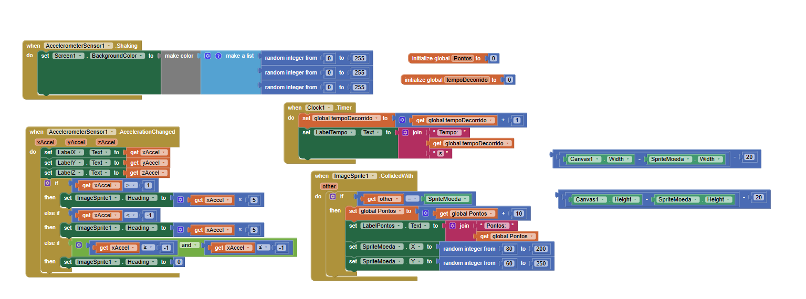

---

# Projeto 2 – Magic Ball

## Objetivo do jogo

O jogo é de uma bola que que deve acertar um buraco preto, no jogo tem um tempo pra você acertar as bolas, e tem uma quantidade específica de bolas para acertar para ganhar o jogo

## Modificações realizadas

Foi adicionado um sistema para a bola ficar cada vez mais rápida, e também quando acertar a bola, você ganhar mais tempo, como por exemplo +3 segundos. Além disso mudamos o visual, para ficar com uma temática de espaço cideral.

---

## Print do Design

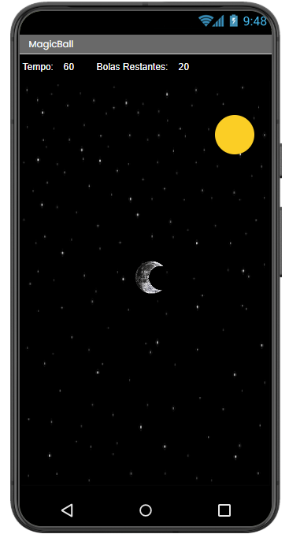

## Print dos Blocos

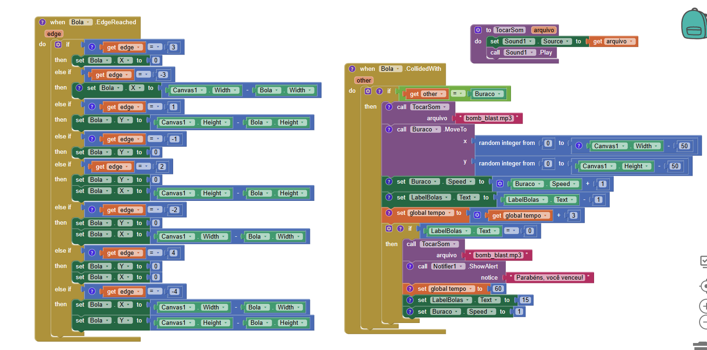
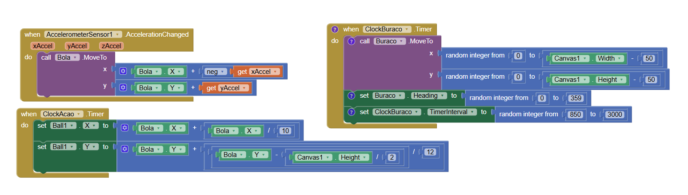
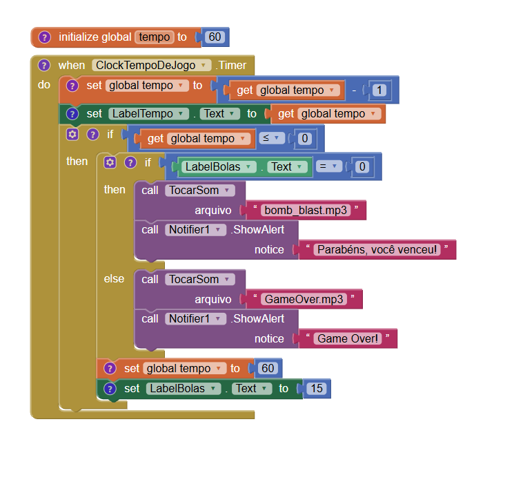

---

# Projeto 3 - Bilhar

## Objetivo do jogo

O jogo simula uma mesa de sinuca com interação direta dos elementos na tela.

## Modificações realizadas

Foi introduzido um sistema de pontuação, que é só acertar a bola nos buracos que você já ganha ponto. Além disso foi introduzido também um sistema de tempo, um tempo para você acertar os buracos. Se você deixar o tempo esgotar você perde e o tempo reseta.

---

## Print do Design

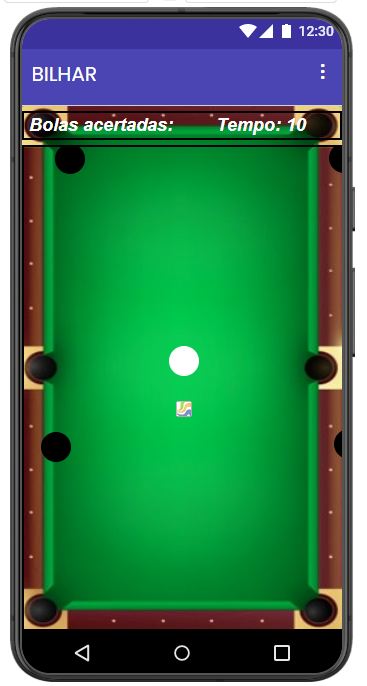

## Print dos Blocos

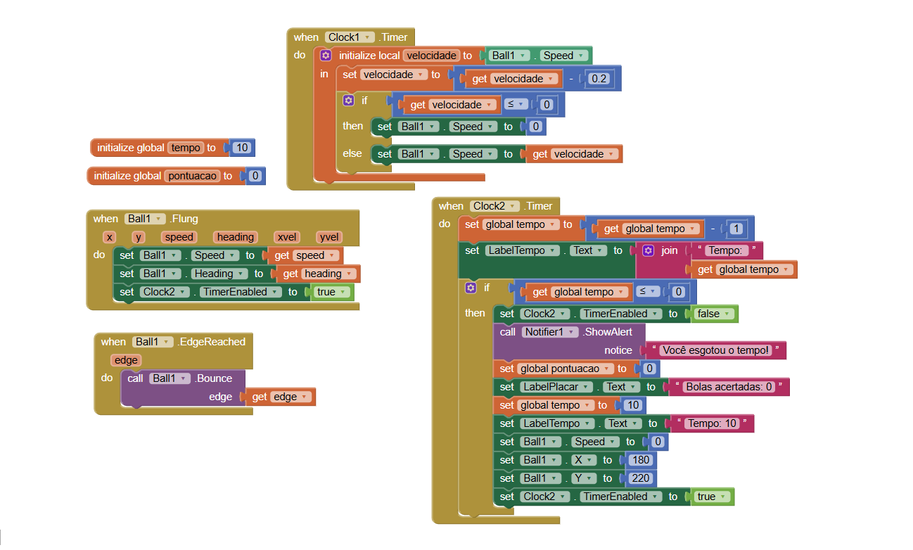
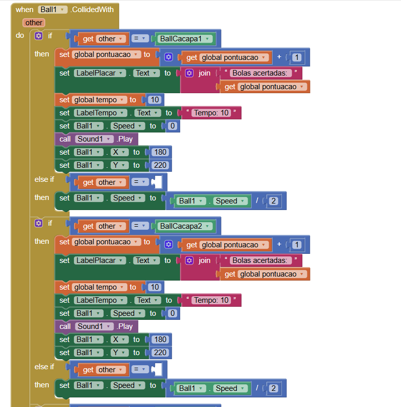
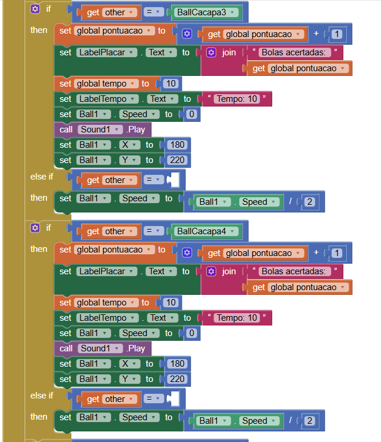
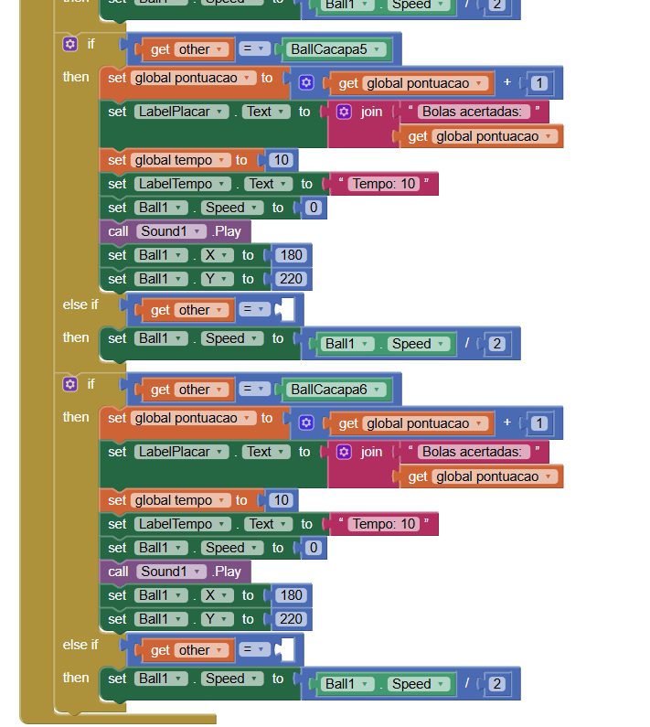

---

# Projeto 4 - PongMaster

## Objetivo do jogo

O jogo consiste em controlar uma barra para impedir que a bola saia da tela, rebatendo-a continuamente. O objetivo é manter a bola em movimento pelo maior tempo possível e acumular pontuação.

## Modificações realizadas

Foi criado um sistema de vidas, onde se você deixar a bola escapar vai descontar uma vida, apenas chegando na vida 0, você tem seus pontos zerados e continua novamente o jogo. Além disso foi implementado um visual novo, como se o jogo se passasse no céu, com a bola virando o Sol, e a barra um bloco de terra, e os blocos de cima sendo as nuvens.

---

## Print do Design

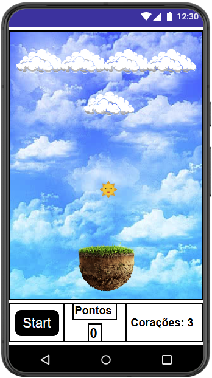

## Print dos Blocos

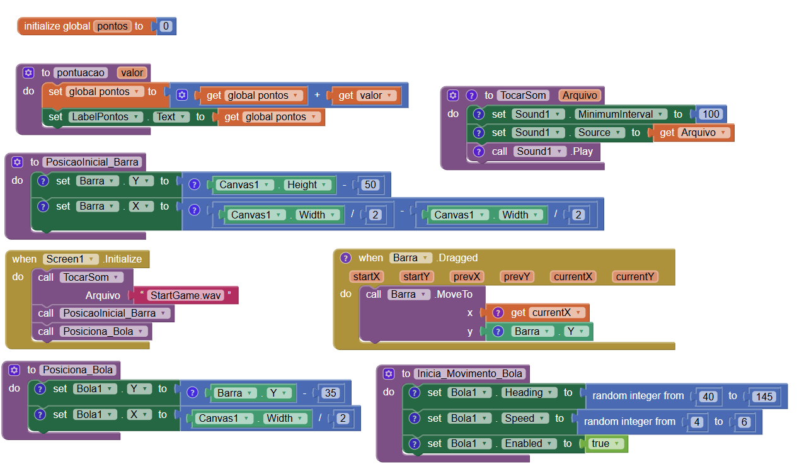
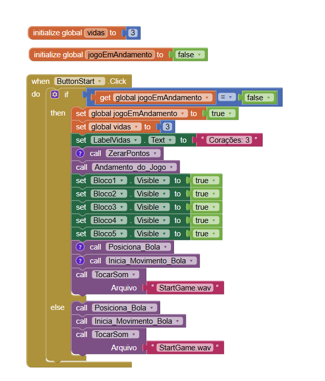
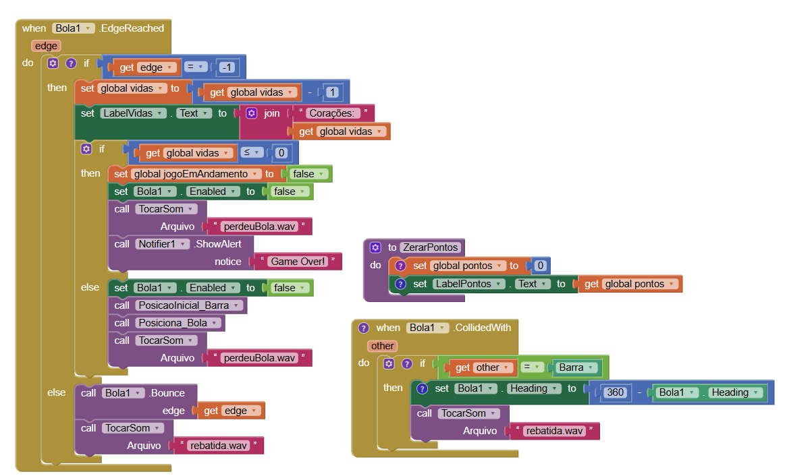
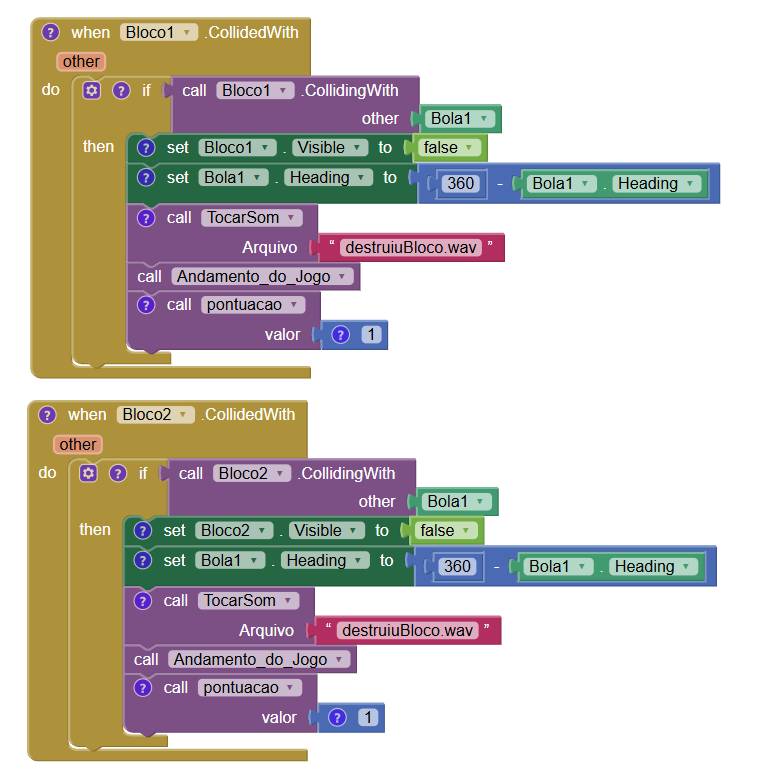
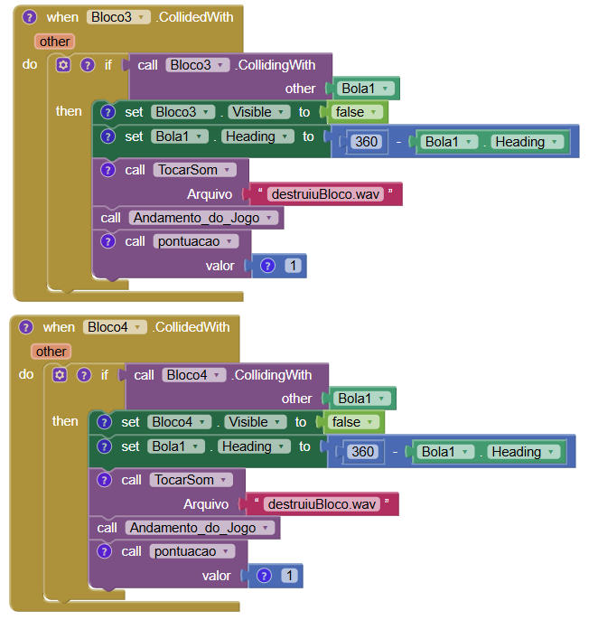
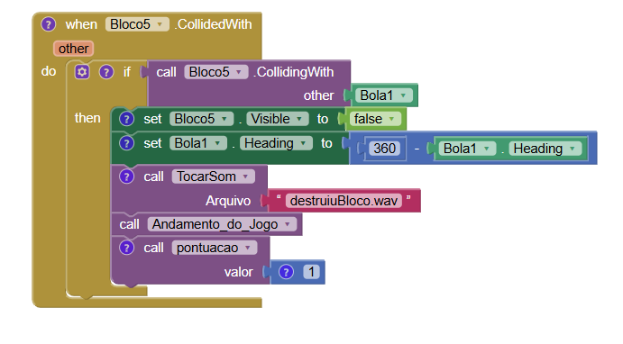
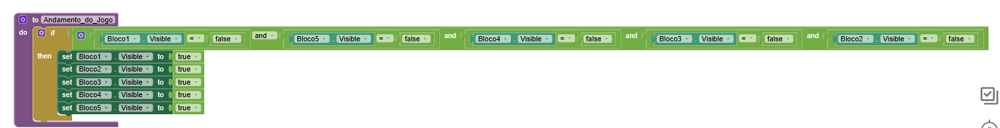

---

# Considerações Finais

O desenvolvimento das alterações nos quatro jogos permitiu aplicar na prática os conceitos estudados na disciplina de Desenvolvimento para Dispositivos Móveis (DDM), utilizando programação por blocos no MIT App Inventor. As modificações realizadas contribuíram para tornar a jogabilidade mais dinâmica, desafiadora e com mecânicas de pontuação e eventos bem definidas.

---

*Relatório desenvolvido para fins educacionais na disciplina de Desenvolvimento para Dispositivos Móveis (DDM), utilizando o MIT App Inventor.*
