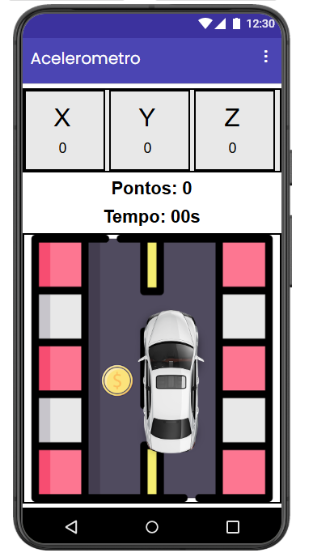

## Instituição

`ETEC Vasco Antônio Venchiarutti`

---

## Curso

`Informática para Internet`

---

## Disciplina

`DDM – Desenvolvimento para Dispositivos Móveis`

---

## Turma

`2°D`

---

## Autores

* `Davi`
* `Kevin`

---

# Relatório – Desenvolvimento de Jogos no MIT App Inventor

## Objetivo

O objetivo deste trabalho foi desenvolver e personalizar três jogos utilizando o MIT App Inventor, aplicando conceitos de programação por blocos, lógica de jogos, física de elementos e utilização dos sensores do dispositivo móvel.

---

# Projeto 1 – Acelerometro

## Objetivo do jogo

O jogo consiste em inclinar seu celular para mostrar as direções X, Y e Z, enquanto o seu carro se move pela tela

## Modificações realizadas

As modificações realizadas foram: controlar seu carro na estrada, tentando pegar as moedas, que seriam seus pontos, em um tempo.

---

## Print do Design

## Print dos Blocos

---

# Projeto 2 – Magic Ball

## Objetivo do jogo

O jogo é de uma bola que que deve acertar um buraco preto, no jogo tem um tempo pra você acertar as bolas, e tem uma quantidade específica de bolas para acertar para ganhar o jogo

## Modificações realizadas

Foi adicionado um sistema para a bola ficar cada vez mais rápida, e também quando acertar a bola, você ganhar mais tempo, como por exemplo +3 segundos. Além disso mudamos o visual, para ficar com uma temática de espaço cideral.

---

## Print do Design

## Print dos Blocos
