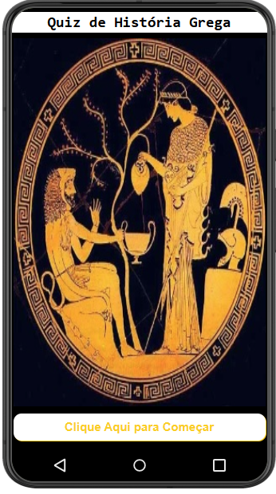
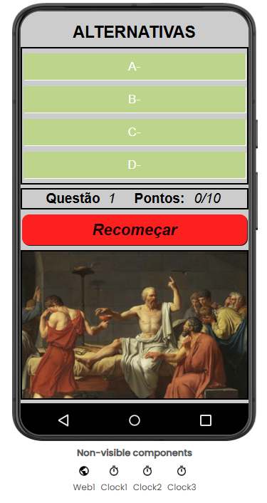
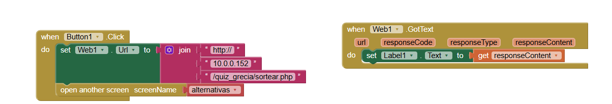
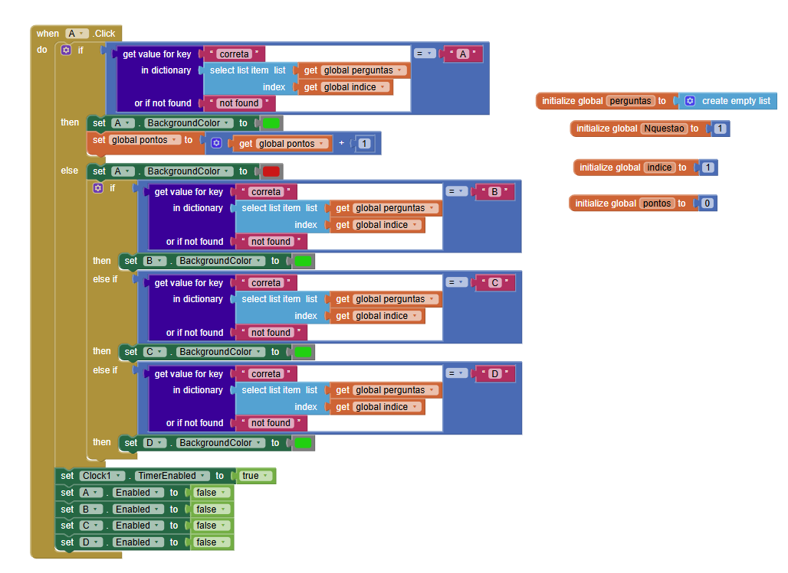
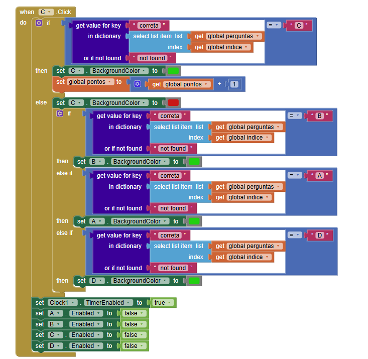
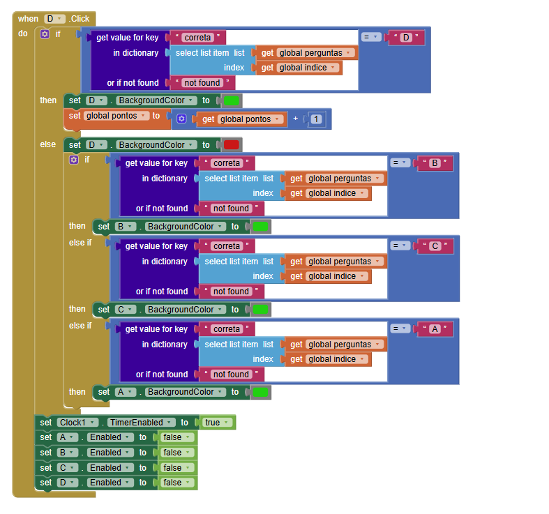
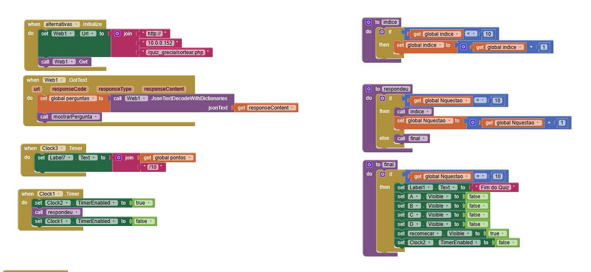
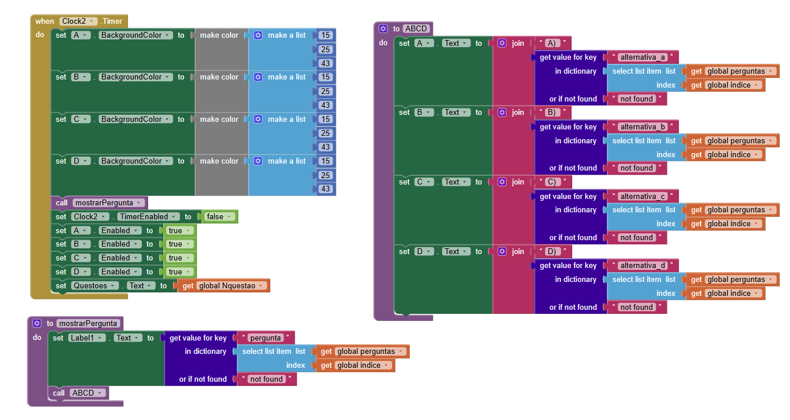
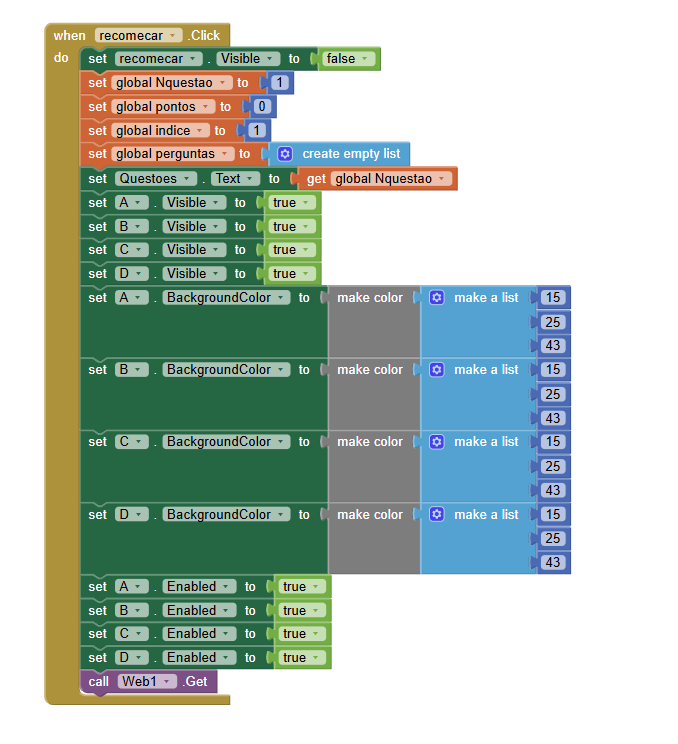

## Instituição

`ETEC Vasco Antônio Venchiarutti`

---

## Curso

`Informática para Internet`

---

## Disciplina

`DDM – Desenvolvimento para Dispositivos Móveis`

---

## Turma

`2°D`

---

## Autores

* `Davi Bressan`
* `Kevin Nozaki`

---

# Relatório – Quiz de História Grega

## Objetivo do aplicativo

O aplicativo tem como objetivo testar e reforçar os conhecimentos do
usuário sobre a História da Grécia Antiga por meio de perguntas de
múltipla escolha.

As perguntas são armazenadas em um banco de dados e carregadas pelo
aplicativo por meio de uma comunicação com arquivos PHP hospedados em um
servidor local (XAMPP). Dessa forma, o conteúdo fica separado da lógica
visual do aplicativo, podendo ser atualizado ou expandido diretamente no
banco de dados.

------------------------------------------------------------------------

## Funcionamento do aplicativo

O aplicativo foi estruturado em duas telas principais no MIT App
Inventor: uma tela inicial temática (*Quiz de História Grega*, com
ilustração clássica e botão para iniciar) e a tela de jogo
(*ALTERNATIVAS*), onde as questões são apresentadas.

Ao abrir a tela de perguntas, o aplicativo realiza uma solicitação ao
servidor local (utilizando o endereço IPv4 da rede local) para buscar as
perguntas disponíveis no banco de dados.

O PHP recebe essa solicitação, consulta a tabela `perguntas` no banco de
dados `QuizHistoriaGrega` e seleciona até 30 perguntas em ordem
aleatória (`ORDER BY RAND()`).

Depois da consulta, o PHP embaralha a ordem das alternativas de cada
questão, atualiza a letra correspondente à resposta certa e transforma o
resultado em JSON. O aplicativo recebe esse conteúdo, converte o JSON em
uma lista de dicionários e apresenta uma pergunta por vez na tela.

O funcionamento pode ser resumido da seguinte maneira:

**Aplicativo solicita as perguntas → PHP recebe a solicitação → PHP
consulta o banco MySQL → perguntas e alternativas são embaralhadas e
organizadas em JSON → servidor local XAMPP envia os dados → aplicativo
recebe, exibe as perguntas, valida as respostas e contabiliza os
pontos.**

Durante o jogo, ao clicar em uma das quatro alternativas (A, B, C ou D):

-   **Se o usuário acertar:** o botão escolhido fica verde e a
    pontuação é incrementada;
-   **Se o usuário errar:** o botão escolhido fica vermelho e o botão
    correspondente à alternativa correta é destacado em verde,
    permitindo que o usuário aprenda a resposta certa antes de avançar
    para a próxima questão;
-   Ao final da rodada, o aplicativo exibe a mensagem de encerramento e
    libera o botão **Recomeçar**, que zera o placar e solicita um novo
    sorteio de perguntas ao servidor.

------------------------------------------------------------------------

## Banco de dados

Foi utilizado o banco de dados `QuizHistoriaGrega` (gerenciado via
XAMPP/MariaDB), contendo a tabela `perguntas` com 50 questões
cadastradas sobre História Grega.

Essa tabela armazena as informações necessárias para cada pergunta,
incluindo:

-   `id`: identificação única da pergunta;
-   `pergunta`: enunciado da questão;
-   `alternativa_a`: texto da alternativa A;
-   `alternativa_b`: texto da alternativa B;
-   `alternativa_c`: texto da alternativa C;
-   `alternativa_d`: texto da alternativa D;
-   `correta`: letra correspondente à resposta correta (`A`, `B`, `C` ou
    `D`).

O banco de dados permite manter as questões organizadas e facilita a
inclusão de novas perguntas sem precisar alterar a programação do
aplicativo.

------------------------------------------------------------------------

## Desenvolvimento do projeto

O desenvolvimento passou pela configuração do ambiente de servidor e
banco de dados, criação do script de sorteio em PHP, montagem das telas
e programação da lógica de blocos no MIT App Inventor:

-   **Configuração do ambiente e banco de dados:** inicialmente foi
    avaliada a utilização do SQL Server, porém optou-se pela migração
    para o XAMPP (Apache + MySQL/MariaDB), garantindo maior
    compatibilidade e estabilidade na conexão com o PHP. Em seguida, foi
    criado o banco `QuizHistoriaGrega` e importadas 50 questões sobre
    Grécia Antiga;
-   **Back-end em PHP:** desenvolvimento e teste do arquivo
    `sortear.php`, responsável por conectar ao banco, sortear 30
    perguntas aleatórias, embaralhar as alternativas e retornar o JSON
    válido para o aplicativo;
-   **Front-end e lógica no MIT App Inventor:** criação da tela
    inicial e da tela `ALTERNATIVAS`, configuração do componente `Web1`
    com o IPv4 local, leitura dos dicionários JSON,
    controle de temporizadores (`Clock1`, `Clock2` e `Clock3`), feedback
    visual em verde e vermelho para acertos e erros, contagem de pontos
    e fluxo de reinício da partida.

------------------------------------------------------------------------

## Programação e comunicação com o servidor

Para que o aplicativo pudesse receber as perguntas armazenadas no banco
de dados e controlar o fluxo do jogo, a comunicação foi organizada nas
seguintes etapas:

### 1. Conexão e consulta ao banco de dados (`sortear.php`)

No servidor local XAMPP, o script `sortear.php` realiza a conexão com o
banco `QuizHistoriaGrega` e executa a consulta SQL na tabela
`perguntas`, selecionando até 30 registros de forma aleatória.

### 2. Embaralhamento e conversão para JSON

Após consultar os registros, o PHP embaralha as alternativas (`A`, `B`,
`C` e `D`) de cada questão e atualiza a chave `correta` para que ela
continue apontando para a resposta certa. Em seguida, os dados são
convertidos para o formato JSON (`json_encode`), permitindo que o
aplicativo leia cada campo pelas chaves `pergunta`, `alternativa_a`,
`alternativa_b`, `alternativa_c`, `alternativa_d` e `correta`.

### 3. Consumo dos dados no MIT App Inventor

Na tela `ALTERNATIVAS`, o componente `Web1` aponta para o endereço local. Quando a resposta chega no
evento `Web1.GotText`, o método `JsonTextDecodeWithDictionaries`
converte o JSON em uma lista de dicionários armazenada na variável
global `perguntas`, e o procedimento `mostrarPergunta` (junto com
`ABCD`) preenche o enunciado e os quatro botões na tela.

### 4. Validação das respostas, temporizadores e reinício

Ao tocar em uma alternativa, o aplicativo compara a letra escolhida com a
chave `correta` do dicionário atual:

-   Em caso de acerto, pinta o botão de verde e soma `+1` em `pontos`;
-   Em caso de erro, pinta o botão clicado de vermelho e verifica qual é
    a letra correta para destacá-la em verde;
-   Os componentes `Clock1`, `Clock2` e `Clock3` controlam o intervalo
    de visualização da resposta, o avanço do índice da questão, a
    atualização do placar e a exibição da tela final com o botão
    `recomecar`, que restaura as variáveis e chama `Web1.Get` novamente.

------------------------------------------------------------------------

## Design e Blocos do app:

