## Instituição 
`ETEC Vasco Antônio Venchiarutti`

---

## Curso
`Informática para Internet`

---

## Turma
`2°D`

---

## Autores
- `Bianca Rocha do Nascimento`
- `Davi Alves Bressan`
- `Gustavo Bastos da Silva`
- `Kevin Iamake Nozaki`

# 📱 Projeto

## Título
Calculadora Econômica

## Objetivo do Aplicativo
O objetivo do aplicativo é auxiliar o usuário no controle de seus gastos pessoais. Por meio dele, é possível registrar despesas e inserir o valor do salário, permitindo visualizar o valor restante disponível. Dessa forma, o aplicativo contribui para uma melhor organização financeira, facilitando o controle e o manuseio do dinheiro no dia a dia. O App foi feito pra ter um design simples, dinâmico e intuitivo para o facil manuseio do App. Algumas configurações foram adicionadas, como a moeda armazenada e o modo escuro, seguindo a preferência do usuário

## Funcionalidade do Aplicativo
O aplicativo apresenta funcionalidades voltadas para o controle financeiro de forma simples e prática. A principal delas é o cálculo automático entre o salário e os gastos inseridos pelo usuário, permitindo visualizar o valor restante de forma rápida. Além disso, o aplicativo conta com configurações personalizáveis, como a seleção de moeda, possibilitando adaptar os valores conforme a preferência do usuário. Também foi implementado o modo escuro, que melhora a visualização em ambientes com pouca luz e proporciona maior conforto durante o uso.

## Conceitos aprendidos na Apostila

Durante o desenvolvimento, foram utilizados vários conceitos aprendidos na apostila. Um deles foi a troca de telas, que permite navegar entre as diferentes partes do aplicativo. Também foi utilizado o uso de botões para realizar ações e modificar conteúdos na tela. Um deles foi a troca de telas, que permite navegar entre as diferentes partes do aplicativo. Também foi utilizado o uso de botões para realizar ações e modificar conteúdos na tela. Outro conceito importante foi o uso de componentes de entrada, permitindo que o usuário interaja com o aplicativo. Além disso, foi aplicado o conceito de personalização visual, como no caso do modo escuro, que melhora a experiência do usuário.

## Conceitos aprendidos na Apostila
Durante o desenvolvimento, foram utilizados vários conceitos aprendidos na apostila. Um deles foi a troca de telas, que permite navegar entre as diferentes partes do aplicativo. Também foi utilizado o uso de botões para realizar ações e modificar conteúdos na tela. Outro conceito importante foi o uso de componentes de entrada, permitindo que o usuário interaja com o aplicativo. Além disso, foi aplicado o conceito de personalização visual, como no caso do modo escuro, que melhora a experiência do usuário.

## Participação de cada integrante
Cada integrante teve um papel importante no desenvolvimento do aplicativo:

- `Kevin: foi responsável por criar a base dos cálculos e também ajudou na construção da primeira tela do aplicativo.`
- `Davi: `
- `Gustavo: fez o refinamento geral do aplicativo, cuidando do design, das configurações e da maior parte da programação.`
- `Bianca: finalizou a programação do modo escuro e também contribuiu melhorando o design do aplicativo.`

## Prints do App

# Prints das telas de Design

## Design da Primeira Versão do App
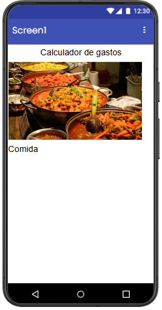
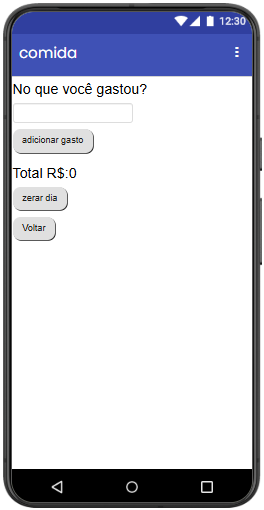

## Design da Segunda Versão do App
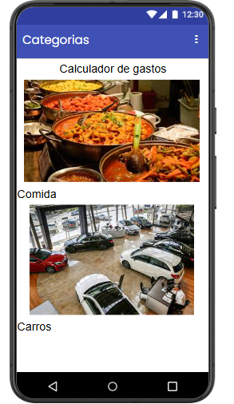
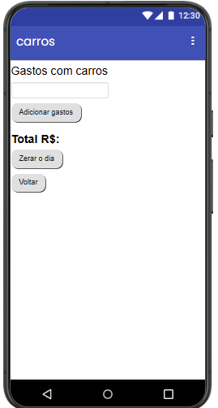

## Design da Terceira Versão do App (final)
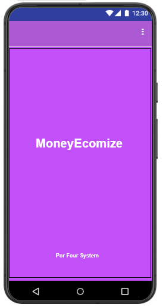
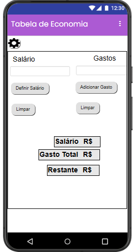
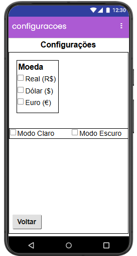

---

## Prints dos Blocos do App
Bloco da Tela de Abertura
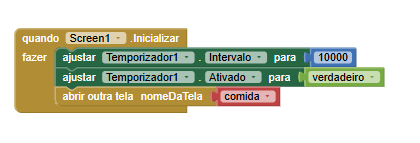

## Bloco dos botões de Salário e Gastos
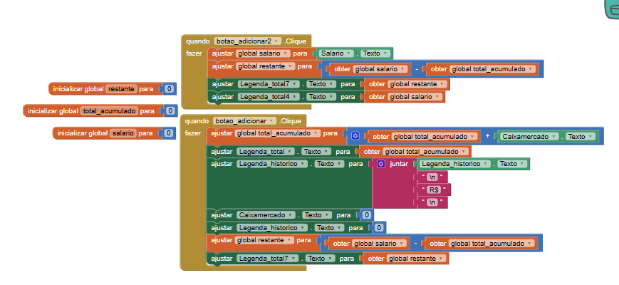

## Limpar Valores
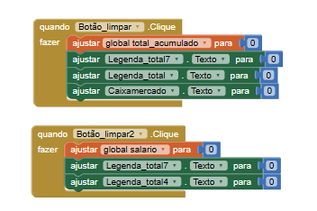

## Ler qual Moeda Usar
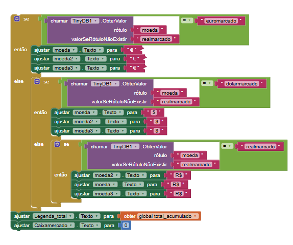

## Bloco dos botões de Salário e Gastos

## Bloco do Botão de Configuração
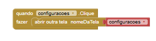

## Bloco das Caixas Seletoras de Moeda
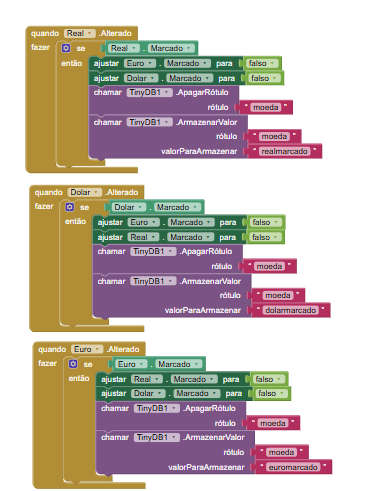

